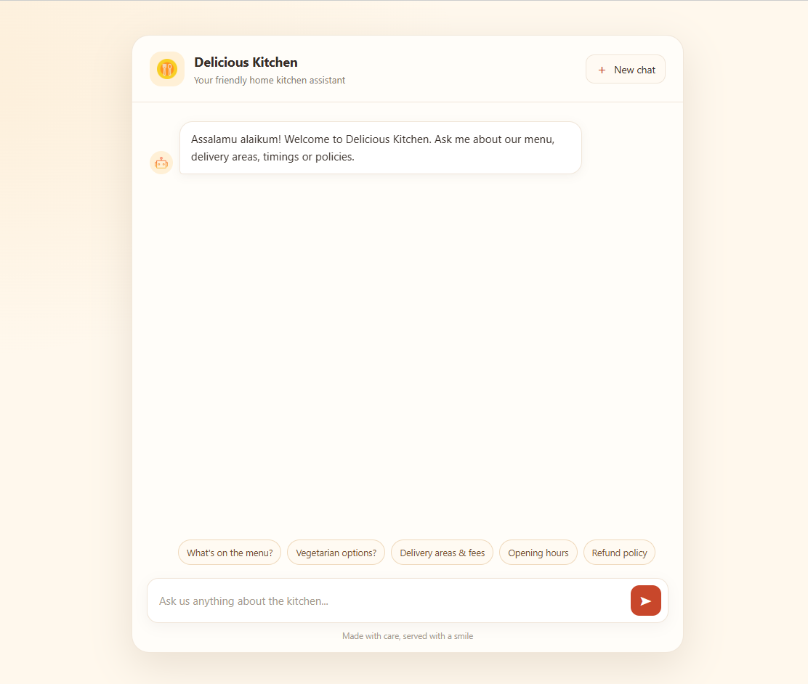
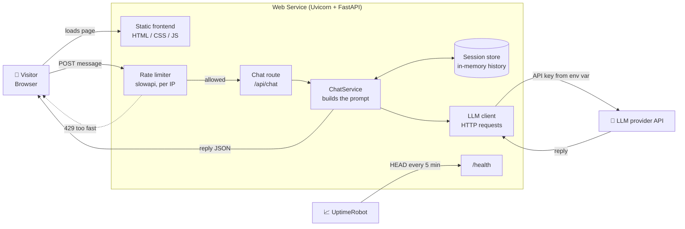
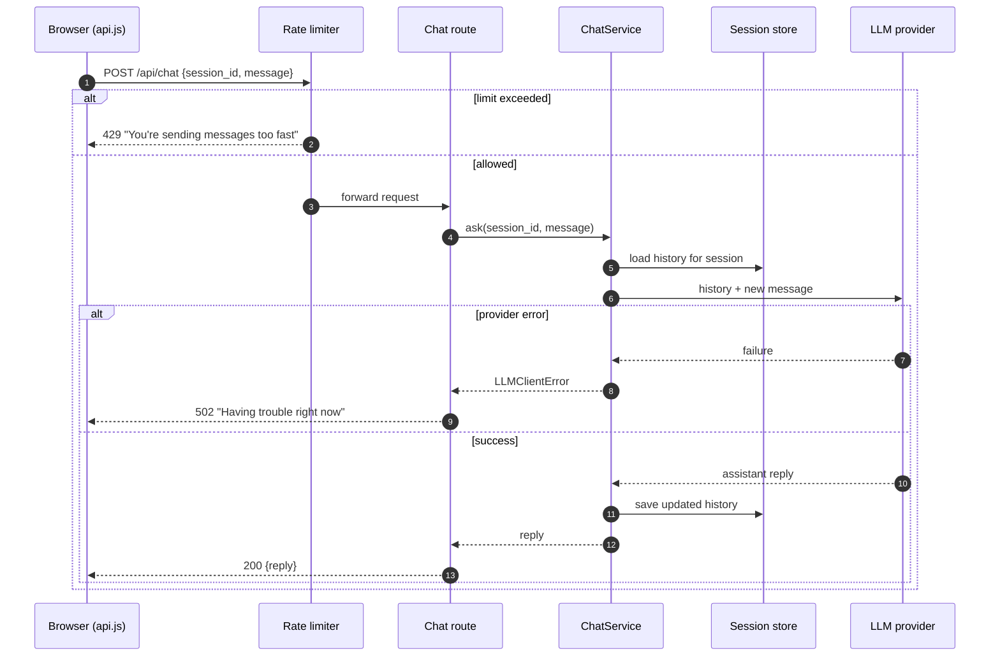

# 🍽️ Delicious Kitchen Chatbot

A restaurant assistant chatbot with a lightweight web frontend and a FastAPI backend. Visitors ask about the restaurant and menu, and the server forwards the conversation to an LLM and returns the reply. The API key stays on the server, and the public endpoint is protected by rate limiting.

**Live demo:** https://delicious-kitchen-chatbot.onrender.com/

---



---

## ✨ Features

- Chat interface served directly by the backend 
- Per-session conversation memory, with a "new chat" button that clears it on the server
- Per-IP rate limiting (`10/minute` and `100/day`) with a friendly error message
- Clean error handling: network problems, rate limits and LLM failures each show a clear message in the chat
- `/health` endpoint (GET and HEAD) for uptime monitoring

---

## 🏗️ Architecture



### Request flow



---

## 🧰 Tech stack

| Layer | Technology |
|---|---|
| Backend | Python 3.12, FastAPI, Uvicorn |
| Rate limiting | slowapi |
| Config | pydantic-settings, python-dotenv |
| LLM calls | `requests` to the provider's HTTP API |
| Frontend | Vanilla HTML, CSS and JavaScript (ES modules) |
| Hosting | Render (Web Service) |
| Monitoring | UptimeRobot |

---

## 📁 Project structure

```
delicious_kitchen_chatbot/
├── app/
│   ├── main.py                # App setup, rate-limit handler, /health, static files
│   ├── api/
│   │   └── routes/
│   │       └── chat.py        # POST /api/chat, DELETE /api/chat/{session_id}
│   ├── clients/
│   │   └── llm_client.py      # Talks to the LLM provider
│   ├── core/
│   │   ├── config.py          # Settings loaded from environment variables
│   │   └── limiter.py         # slowapi limiter (per-IP)
│   ├── schemas/
│   │   └── chat.py            # ChatRequest / ChatResponse models
│   ├── services/
│   │   ├── chat_service.py    # Chat logic
│   │   └── session_store.py   # In-memory conversation history
│   └── static/                # Frontend (index.html, CSS, JS incl. api.js)
├── requirements.txt
├── .gitignore
└── README.md
```

---

## 🔌 API

| Method | Path | Description | Success | Errors |
|---|---|---|---|---|
| `POST` | `/api/chat` | Send a message and get a reply | `200` | `422` invalid body, `429` rate limited, `502` LLM failure |
| `DELETE` | `/api/chat/{session_id}` | Clear a session's history | `204` | `422` invalid session id |
| `GET`, `HEAD` | `/health` | Liveness check for Web Service and UptimeRobot | `200` | none |
| `GET` | `/` | Serves the chat page | `200` | none |

**Example**

```bash
curl -X POST http://localhost:8000/api/chat \
  -H "Content-Type: application/json" \
  -d '{"session_id": "demo-session-1", "message": "What vegetarian dishes do you have?"}'
```

```json
{ "reply": "..." }
```

---

## 🚀 Run locally

**Prerequisites:** Python 3.12 and an API key from your LLM provider.

```powershell
# 1. Clone
git clone https://github.com/Fouad-Showmik/Delicious-Kitchen-Chatbot.git
cd Delicious-Kitchen-Chatbot

# 2. Create and activate a virtual environment (Windows PowerShell)
python -m venv .venv
.venv\Scripts\activate

# 3. Install dependencies
pip install -r requirements.txt

# 4. Create your .env file from the example, then fill in your values
copy .env.example .env

# 5. Start the server
uvicorn app.main:app --reload
```

On macOS or Linux, activate the venv with `source .venv/bin/activate` and use `cp` instead of `copy`.

Open http://localhost:8000.

### Environment variables

Create a `.env` file in the project root. **Never commit it** (it is listed in `.gitignore`).

```env
# Names must match app/core/config.py
LLM_API_KEY=your-provider-key-here
MODEL_NAME=your-model-name
```

---

## 🔒 Security and cost protection

The chat endpoint is public by design, so the project limits how much any one visitor can spend:

- **Per-IP rate limits:** 10 requests per minute and 100 per day (slowapi)
- **Server-side API key:** the LLM key lives only in Server's environment variables
- **Input limits:** message length is capped in `ChatRequest`
- **Short replies:** `max_tokens` is capped on LLM calls
- **Provider spending cap:** a monthly budget or alert is set in the LLM provider's dashboard

### Known limitations

- Rate-limit counters and chat sessions are stored **in memory**. They reset when server restarts the app, and they are not shared across multiple workers, so the app runs with a single worker.
- A public endpoint can't fully block scripted use. If abuse appears, add a bot check such as Cloudflare Turnstile.

---

## 🗺️ Roadmap

- [ ] Persistent sessions (Redis or a database)
- [ ] Cloudflare Turnstile bot protection
- [ ] Streaming replies
- [ ] Automated tests and CI

---

## 🤝 Contributing

Issues and pull requests are welcome. Please don't include API keys or `.env` files in commits.

## 📄 License

This project is licensed under the MIT License. See the [LICENSE](LICENSE) file for details.

## 👤 Author

**Mutasim Fouad Showmik**
